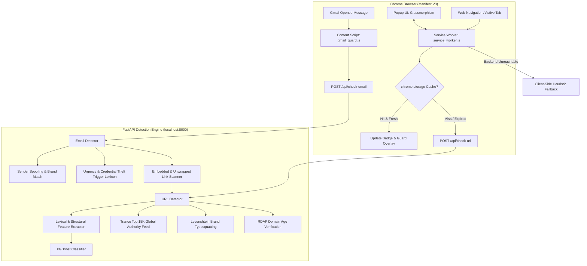

# 🛡️ PhishGuard AI - Real-Time Phishing & Email Shield

[](https://fastapi.tiangolo.com/)
[](https://xgboost.readthedocs.io/)
[](https://developer.chrome.com/docs/extensions/mv3/)
[](https://www.python.org/)
[](LICENSE)
[](backend/tests/)

**PhishGuard AI** is a dual-layer cybersecurity solution combining a **Manifest V3 Chrome Extension** and a **FastAPI Machine Learning Detection Engine**. It protects users in real time against malicious phishing websites, typosquatting domains, and credential-harvesting emails in Gmail/Webmail.

---

## Architecture



---

## Key Features

1. **Real-Time Navigation Guard**:
   - Inspects navigations automatically on `tabs.onUpdated`.
   - Full-screen warning overlay for high-threat phishing pages; alert banner for suspicious sites.
   - Dynamic extension icon badge (`✓`, `?`, `!`) reflecting current tab security score.

2. **Gmail & Webmail Shield**:
   - Observes opened messages via DOM `MutationObserver`.
   - Unwraps Google redirect URLs (`google.com/url?q=...`) to inspect true destinations.
   - Filters out Gmail internal UI and attachment controls (`view=att`).
   - Detects display-name brand spoofing and high-pressure credential phishing.
   - Injects a security trust header directly above the message body.

3. **Hybrid Detection Engine**:
   - **XGBoost Classifier**: 21 normalized lexical and structural URL features.
   - **Tranco Top 15K Global Authority Feed**: Cached $O(1)$ lookup for high-reputation domains with registered root domain matching (`get_registered_domain`).
   - **Evidence-First Scoring**: Prevents false alarms on unlisted benign sites by requiring corroborated threat indicators before escalating risk.
   - **Levenshtein Typosquatting**: Detects mutations of popular corporate brands (`paypa1`, `arnazon`, `g00gle`).
   - **Domain Age & RDAP Inspection**: Identifies newly registered domains (<30 days old) via fast asynchronous queries.

4. **Offline Resilience & Caching**:
   - 1-hour persistent caching in `chrome.storage.local` for instant $0$ms lookups on repeat visits.
   - Client-side heuristic fallback inside the service worker if the backend is offline.

5. **User Experience & Management**:
   - Dark glassmorphism popup dashboard with risk gauge (0–100).
   - On-demand single URL scanner and CSV history export.
   - User allowlist / whitelist with one-click domain trust.
   - Right-click context menu: *"Scan Link with PhishGuard AI"*.
   - Configurable sensitivity modes: **Aggressive** (50), **Balanced** (70), **Permissive** (85).

---

## Project Structure

```text
phishing_detection/
├── SPEC.md                           # Technical specification (v1.0 – v1.3)
├── tasks.md                          # Engineering task list & test verification
├── README.md                         # Project documentation
├── backend/                          # FastAPI Backend Detection Service
│   ├── main.py                       # REST API endpoints (/check-url, /check-email, /check-urls)
│   ├── requirements.txt              # Backend Python dependencies
│   ├── data/
│   │   └── top_domains.txt           # Top 15,000 global domains (Tranco authority feed)
│   ├── models/
│   │   ├── url_xgboost_tuned.json    # Tuned XGBoost model artifact
│   │   ├── url_xgboost_tuned_features.json # Model feature schema
│   │   └── url_model.joblib          # Fallback model artifact
│   ├── services/
│   │   ├── url_detector.py           # Feature extraction, ML inference & composite scoring
│   │   ├── email_detector.py         # Sender spoofing, urgency heuristics & link analysis
│   │   └── heuristics.py             # Tranco feed, Levenshtein distance & RDAP age lookup
│   └── tests/                        # Automated Pytest suite (24 tests)
│       ├── test_api_endpoints.py     # API endpoint integration tests
│       ├── test_email_detector.py    # Email phishing & spoofing tests
│       ├── test_heuristics_v11.py    # Typosquatting & Tranco loader tests
│       └── test_url_detector.py      # URL classifier & unmasking tests
├── extension/                        # Manifest V3 Chrome Extension
│   ├── manifest.json                 # Extension configuration & permissions
│   ├── background/
│   │   └── service_worker.js         # Navigation listener, cache, context menu & offline fallback
│   ├── content/
│   │   ├── url_guard.js              # In-browser warning overlay & disguised link hover
│   │   ├── gmail_guard.js            # Gmail DOM inspector & security badge injection
│   │   └── guard_overlay.css         # Security card & banner stylesheets
│   ├── popup/
│   │   ├── popup.html                # Dark glassmorphism dashboard UI
│   │   ├── popup.css                 # Gauge animations & glassmorphism theme
│   │   └── popup.js                  # Threat gauge, history, CSV export & allowlist logic
│   └── icons/                        # Extension icon assets (16x16, 48x48, 128x128)
└── mlservices/                       # Machine Learning Training Pipeline
    ├── datasets/                     # Raw Tranco & PhishTank datasets
    ├── models/                       # Training model outputs
    └── src/url/                      # Feature extraction, ablation & model tuning scripts
```

---

## Quick Start

### 1. Backend Setup

Prerequisites: **Python 3.10+**

```bash
# Clone and enter the repository
cd phishing_detection

# Create and activate virtual environment
python -m venv venv
# On Windows:
.\venv\Scripts\activate
# On Linux/macOS:
source venv/bin/activate

# Install dependencies
pip install -r backend/requirements.txt
```

### 2. Run the Backend API

```bash
uvicorn backend.main:app --host 127.0.0.1 --port 8000 --reload
```

- **API Endpoint**: `http://127.0.0.1:8000`
- **Interactive Swagger Docs**: [http://127.0.0.1:8000/docs](http://127.0.0.1:8000/docs)
- **ReDoc**: [http://127.0.0.1:8000/redoc](http://127.0.0.1:8000/redoc)

Verify health:
```bash
curl http://127.0.0.1:8000/api/health
# {"status":"healthy","service":"phishing-shield-api","version":"1.0.0"}
```

### 3. Install Chrome Extension

1. Open Google Chrome (or any Chromium browser: Brave, Edge).
2. Go to `chrome://extensions/`.
3. Enable **Developer mode** (toggle in top-right corner).
4. Click **Load unpacked**.
5. Select the `extension/` directory in this repository.
6. The PhishGuard shield icon will appear in your browser toolbar.

---

## API Reference

### `POST /api/check-url`

Analyze a single URL for phishing threats.

```bash
curl -X POST http://127.0.0.1:8000/api/check-url \
  -H "Content-Type: application/json" \
  -d '{"url": "http://paypa1-security-verify.xyz/login"}'
```

```json
{
  "url": "http://paypa1-security-verify.xyz/login",
  "resolved_url": null,
  "is_shortened": false,
  "threat_score": 95.0,
  "verdict": "phishing",
  "risk_level": "HIGH",
  "ml_probability": 0.999,
  "reasons": [
    "Domain impersonates known brand via typosquatting: 'paypal'",
    "Suspicious top-level domain: '.xyz'",
    "Contains security-sensitive keyword(s): login"
  ]
}
```

### `POST /api/check-email`

Analyze email headers, sender identity, body text, and embedded hyperlinks.

```bash
curl -X POST http://127.0.0.1:8000/api/check-email \
  -H "Content-Type: application/json" \
  -d '{
    "sender_name": "PayPal Support",
    "sender_email": "support-alert@gmail.com",
    "subject": "Urgent: Account Suspended",
    "body_text": "Verify your identity within 24 hours or your account will be locked.",
    "links": ["http://paypa1-verify.xyz/login"]
  }'
```

```json
{
  "threat_score": 95.0,
  "verdict": "phishing",
  "risk_level": "HIGH",
  "sender": {
    "name": "PayPal Support",
    "email": "support-alert@gmail.com"
  },
  "subject": "Urgent: Account Suspended",
  "reasons": [
    "Sender claims brand 'Paypal' in display name, but email domain is 'gmail.com'",
    "Sender uses free public email service (@gmail.com) while claiming to be 'Paypal'",
    "High-urgency fear/coercion language detected: account suspended, verify your identity, suspended within 24 hours",
    "Email contains high-risk phishing URL (95.0/100)"
  ],
  "link_count": 1,
  "analyzed_links": [
    {
      "url": "http://paypa1-verify.xyz/login",
      "threat_score": 95.0,
      "verdict": "phishing",
      "reasons": [
        "Domain impersonates known brand via typosquatting: 'paypal'",
        "Suspicious top-level domain: '.xyz'",
        "Contains security-sensitive keyword(s): login"
      ]
    }
  ]
}
```

### `POST /api/check-urls`

Batch inspection of multiple URLs in a single request.

---

## Automated Testing

Run the test suite covering API endpoints, email analysis, typosquatting, shortener unmasking, and Tranco feed lookups:

```bash
python -m pytest backend/tests/ -v
```

All **24 tests** run with zero failures:
- `backend/tests/test_api_endpoints.py` (5 tests)
- `backend/tests/test_email_detector.py` (5 tests)
- `backend/tests/test_heuristics_v11.py` (5 tests)
- `backend/tests/test_url_detector.py` (9 tests)

---

## Security & Privacy

- **Local Processing**: Scans execute locally on your machine (`127.0.0.1:8000`).
- **Zero Cloud Transmission**: Email body text and browsing activity are never forwarded to third-party clouds or external servers.
- **Minimal Permissions**: The extension only requests standard Manifest V3 permissions required for security scanning (`tabs`, `storage`, `activeTab`, `contextMenus`, `notifications`).

---

## License

This project is licensed under the [MIT License](LICENSE).
